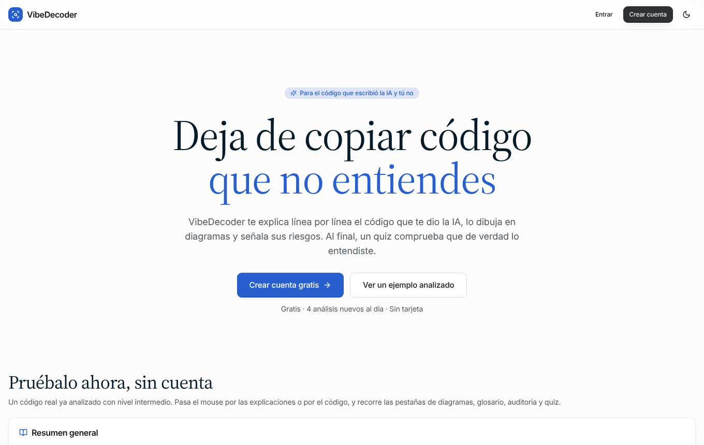
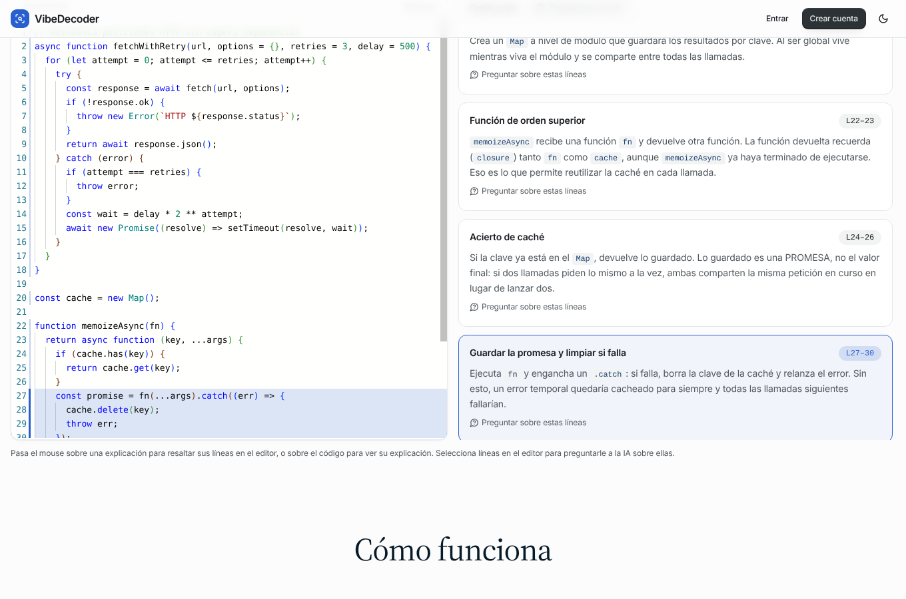
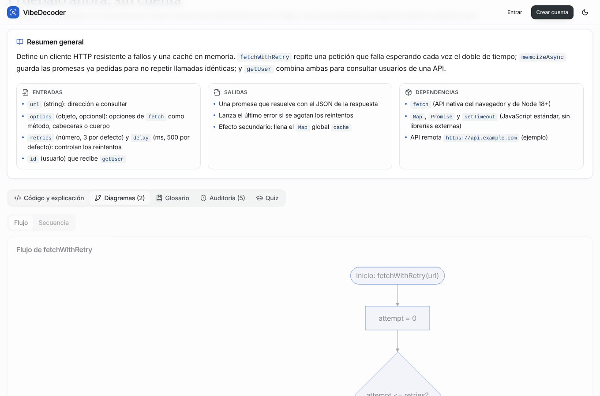
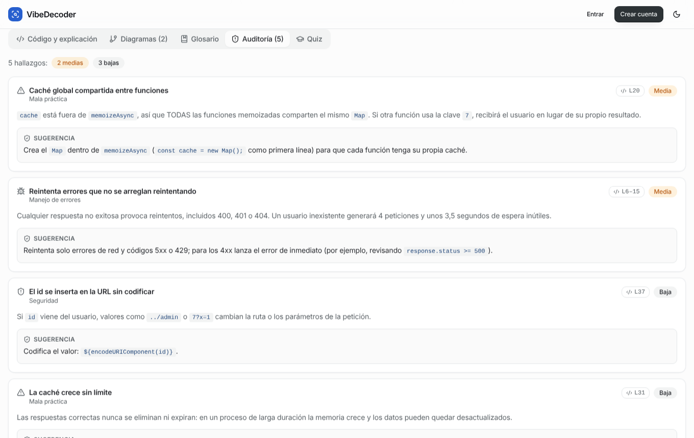
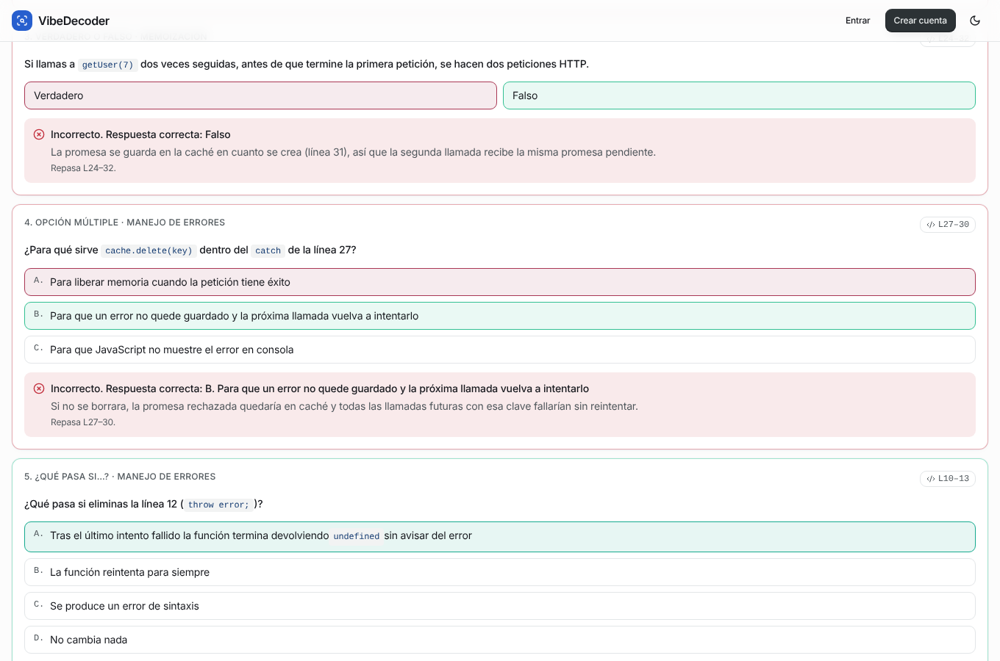
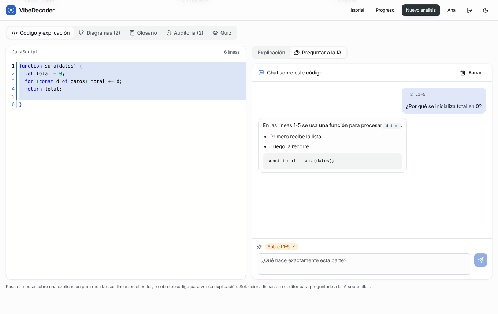
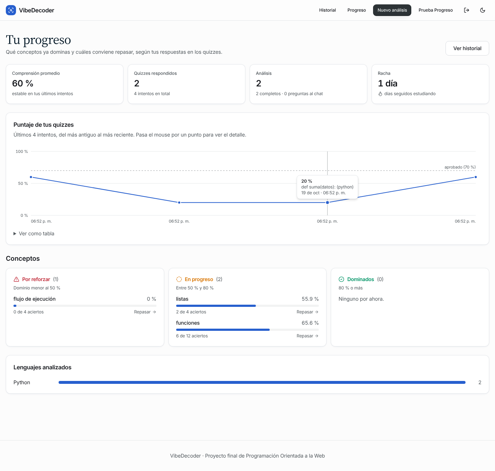
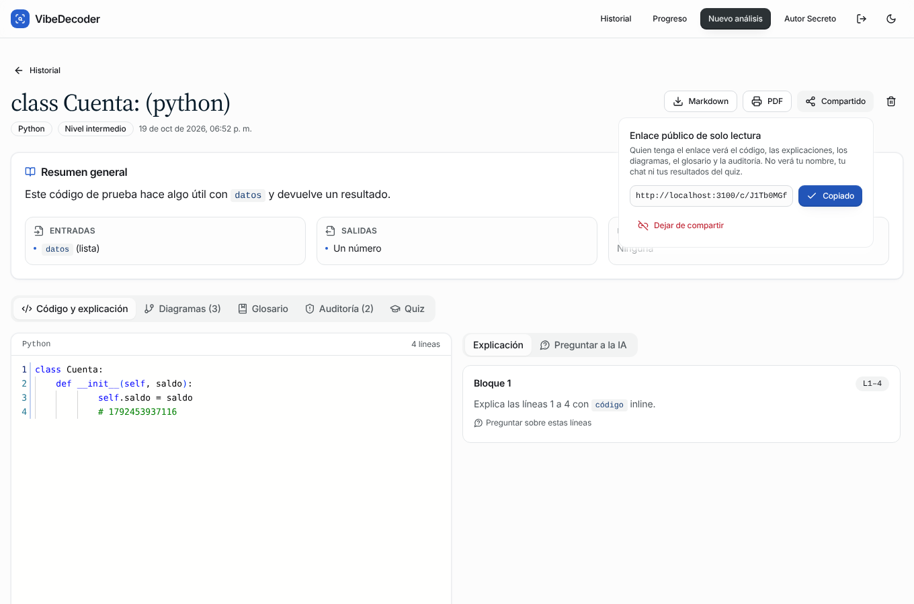
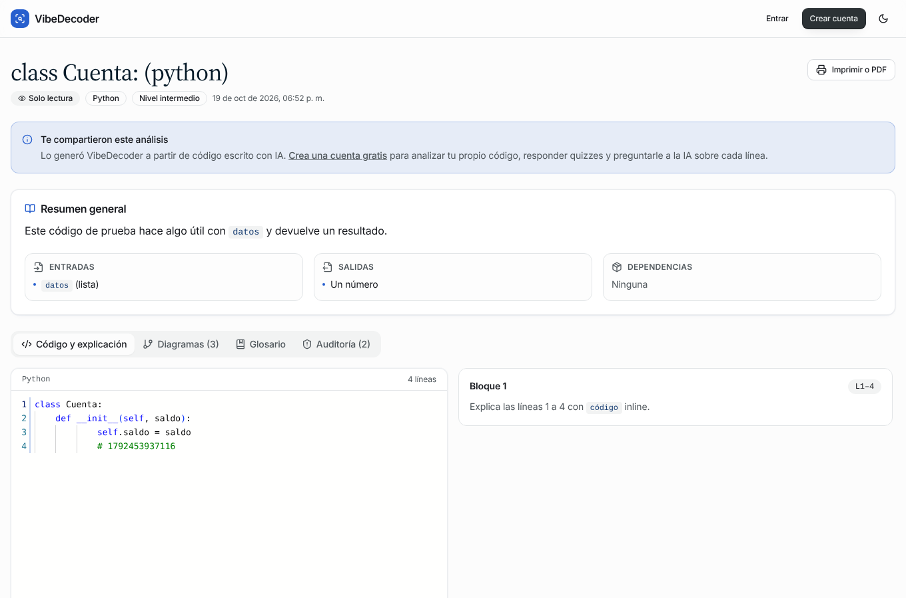

# VibeDecoder · Frontend

> Entiende el código que generó la IA: explicación línea por línea, diagramas, glosario, auditoría de «vibe code», quiz de comprensión y un chat para preguntar sobre cualquier línea.

Proyecto final de **Programación Orientada a la Web**. Este repositorio es la aplicación web (Next.js); la API vive en [vibedecoder-backend](https://github.com/Jhoan-Pd/vibedecoder-backend).

| Fase | Contenido | Estado |
|------|-----------|--------|
| 1 | Auth, BD, editor Monaco, Gemini, resumen + explicación línea por línea sincronizada, diagrama de flujo, historial, despliegue | Hecha |
| 2 | Quiz con calificación, auditoría de vibe code, glosario, diagramas de clases y secuencia, caché y límite diario | Hecha |
| 3 | Chat contextual, dashboard de progreso, exportar (Markdown/PDF) y compartir, respaldo con Groq, pruebas, README final | Hecha |

## El problema

Los desarrolladores copian código generado por IA que funciona pero no entienden. Eso crea deuda técnica, errores de seguridad invisibles y personas que dependen de la IA sin aprender.

## La solución

El usuario pega código (editor, archivo o Gist) y VibeDecoder lo analiza adaptándose a su nivel (principiante, intermedio o avanzado):

| Función | Qué hace |
|---|---|
| Resumen | Propósito, entradas, salidas y dependencias. |
| Explicación línea por línea | Vista dividida: código en Monaco a la izquierda, explicación por bloques a la derecha. Al pasar el mouse por un lado se resalta el otro. |
| Diagramas | Flujo siempre; clases y secuencia cuando el código los justifica. Validados con `mermaid.parse()` y con «Corregir con IA» si fallan. |
| Glosario | Conceptos usados en el código, con enlace a las líneas donde aparecen. |
| Auditoría de vibe code | Seguridad, malas prácticas, código muerto, manejo de errores y posibles alucinaciones de la IA (APIs que no existen), con severidad y sugerencia. |
| Quiz | 5 tipos de pregunta (opción múltiple, qué imprime, verdadero/falso, qué pasa si, ordenar pasos). Se califica en el servidor; si sacas menos del 70 % te dice qué líneas repasar. |
| Chat contextual | Selecciona líneas en el editor y pregunta sobre ellas. La conversación se guarda por análisis. |
| Progreso | Conceptos dominados, en progreso y por reforzar; evolución del puntaje; lenguajes; racha de días. |
| Exportar y compartir | Descarga en Markdown, versión para imprimir o guardar como PDF y enlace público de solo lectura que se puede revocar. |

## Capturas

| Landing con demo | Resaltado sincronizado | Diagrama |
|---|---|---|
|  |  |  |

| Auditoría | Quiz calificado | Chat sobre unas líneas |
|---|---|---|
|  |  |  |

| Progreso | Compartir | Vista pública |
|---|---|---|
|  |  |  |

Las capturas de la demo usan el análisis precalculado de la landing. Las de chat, progreso y compartir se tomaron en las pruebas locales con un servidor que simula al LLM, así que el texto de las respuestas es de prueba.

## Stack

Next.js 15 (App Router, React 19) · TypeScript · ConnectRPC 2 (`@connectrpc/connect-web`) + Protobuf-ES 2 · Auth.js v5 · TailwindCSS 3 + componentes estilo shadcn/ui · Monaco Editor · Mermaid · Vitest · Vercel. Tipografía Inter y Source Serif 4 (autoalojadas con @fontsource).

## Arquitectura

```
Navegador ──(Connect, JSON por fetch, streaming)──▶ Backend (Fastify + ConnectRPC, Render) ──▶ PostgreSQL · Gemini/Groq
    │                                                     ▲
    └──(HTML, RSC)──▶ Next.js en Vercel ──(Connect)──────┘
                      · Server Components con el token del usuario
                      · Auth.js (sesión) y /api/backend-token
```

- **Contrato primero.** Los `.proto` son del backend; `npm run proto:sync` los copia aquí y `buf generate` crea `src/gen`. La CI falla si el código generado no coincide con los `.proto`.
- **Anti-corruption layer.** `src/lib/rpc/mappers.ts` convierte los mensajes protobuf (enums numéricos, `Timestamp`, campos sin valor) en los view models de `src/types/analysis-view.ts` (uniones de texto, fechas ISO, `null`). Los componentes nunca ven protobuf.
- **Dos clientes Connect.**
  - `src/lib/rpc/server.ts` (solo servidor): cliente del usuario, cliente de servicio y cliente público con caché de datos de Next.
  - `src/lib/rpc/browser.ts`: el navegador llama al backend directamente, con un token de 5 minutos que pide a `/api/backend-token` y guarda en memoria (`TokenCache`).
- **Autenticación entre servicios.** Auth.js mantiene la sesión en una cookie que nunca sale de Vercel. El servidor firma JWT HS256 (`BACKEND_JWT_SECRET`, compartido con el backend) con `scope: "user"` o `scope: "service"`. El login con contraseña usa `VerifyCredentials` y Google/GitHub usan `LinkOAuthAccount`; ambos solo aceptan el token de servicio.
- **Errores.** `src/lib/rpc/errors.ts` traduce cada `ConnectError` a un mensaje en español: el del backend cuando lo hay, y «sin conexión», «el servidor está despertando» o «tardó demasiado» cuando el backend no alcanzó a responder.
- **Textos.** Todo el código está en inglés; lo que lee la persona está en español en `src/i18n/es/*` (un archivo por área).

### Patrones de rendering por ruta

| Ruta | Patrón | Por qué |
|---|---|---|
| `/` | **SSG** + islas de cliente | Igual para todos; la demo está precalculada. Solo el CTA y la barra leen la sesión, en el navegador (`SessionProvider`). El layout raíz no llama a `auth()`, así que no lee cookies. |
| `/dashboard`, `/progress` | **SSR + streaming** (Suspense) | Datos privados. El encabezado llega de inmediato y la lista llega en streaming cuando responde el backend (que puede estar despertando). |
| `/analysis/[id]` | **SSR** + Client Components, con `loading.tsx` | El servidor trae el análisis y el chat en paralelo. El visor (Monaco, Mermaid, quiz) se hidrata para la interacción. `router.refresh()` vuelve a leer tras regenerar una etapa. |
| `/analyze` | **SSR** del nivel y el cupo + **CSR** con streaming de servidor | El progreso de las seis etapas llega evento a evento por `AnalysisService.Analyze`. |
| `/c/[token]` y `/c/[token]/print` | **ISR**, `revalidate = 60` | Enlace público cacheable. `GetSharedAnalysis` es `NO_SIDE_EFFECTS`, así que se pide por HTTP GET y entra en la caché de datos de Next. |
| `/analysis/[id]/print` | **SSR** | Documento para «Guardar como PDF», casi sin JavaScript. |
| `/analysis/[id]/export` | Route Handler | Genera el Markdown a partir de `GetAnalysis`. |
| `/api/health` | Route Handler dinámico | Despierta el backend y la base de datos (cron diario). |

Las rutas antiguas en español (`/progreso`, `/perfil`, `…/imprimir`) redirigen con 301 a las nuevas (`next.config.mjs`).

### Estructura

```
src/
  app/            rutas (App Router)
  components/     UI (ui/ = base estilo shadcn), visor y paneles (viewer/), análisis nuevo (analyze/), impresión, progreso
  lib/rpc/        clientes Connect, tokens, errores, mappers y consultas del servidor
  lib/            lógica pura y probada (visor, quiz, progreso del stream, exportar, lenguajes, demo)
  i18n/es/        textos en español por área
  types/          view models
  gen/            código generado desde los .proto (no se edita a mano)
proto/            copia del contrato del backend
test/             Vitest
```

## Desarrollo local

Necesitas el backend corriendo (ver su README). Para probar sin clave de Gemini, el backend trae un sustituto: `npm run mock:llm` y `GEMINI_BASE_URL=http://localhost:4100`.

```bash
cp .env.example .env.local   # BACKEND_URL, NEXT_PUBLIC_BACKEND_URL, BACKEND_JWT_SECRET (el mismo del backend), AUTH_SECRET
npm install                  # también copia Monaco a public/monaco
npm run dev                  # http://localhost:3000
```

- `npm test`: 57 pruebas de Vitest (reducer del stream, errores de RPC, caché de tokens, quiz, visor, exportación, OAuth…).
- `npm run typecheck` y `npm run build`.
- `npm run proto:sync` cuando cambie el contrato del backend.

## Despliegue

Ver [docs/deployment.md](docs/deployment.md). En resumen:

- Vercel con `BACKEND_URL`, `NEXT_PUBLIC_BACKEND_URL`, `BACKEND_JWT_SECRET` y `AUTH_SECRET`, más las claves de Google/GitHub si se usan.
- El frontend ya no necesita `DATABASE_URL` ni claves de IA: viven solo en el backend.

### Mantener los servicios activos

- El cron diario de Vercel (`vercel.json`) llama a `/api/health`, que despierta el backend y hace una consulta a la base.
- El workflow `.github/workflows/keep-alive.yml` hace lo mismo desde GitHub Actions. Necesita la variable `FRONTEND_URL`.
- El backend tiene su propio workflow diario.
